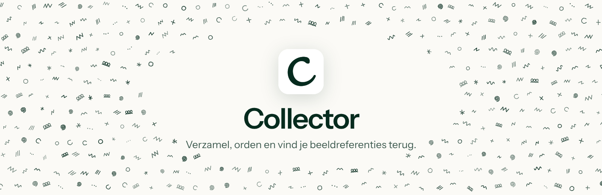
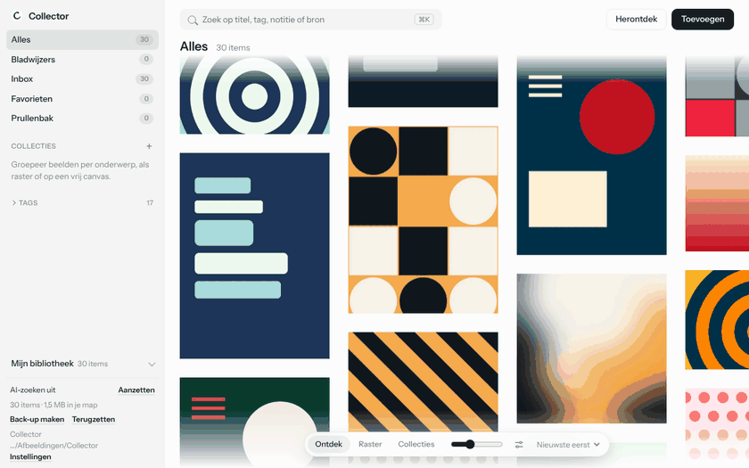

<p align="center"></p>

Collector is een Mac-app voor ontwerpers die veel beeld bewaren: screenshots, posters, kleurstudies, typografie, alles wat je ooit nog eens terug wilt zien. Je begint niet in een lijst maar in een wand van je eigen beelden die zacht drijft, zodat je weer tegenkomt wat je vergeten was.

Twee dingen staan voorop:

- **Je bestanden blijven van jou.** Alles staat als gewone bestanden in een map die jij kiest, op je Mac of op een netwerkschijf. Geen account, geen cloud.
- **Verzamelen moet licht voelen.** Eén toets om iets te bewaren, één toets om iets te waarderen, en ordenen doe je pas als je er zin in hebt.

<p align="center"></p>

## Wat je ermee doet

| | |
|---|---|
| **Ontdekken** | De app opent in een eindeloze wand. Sleep om te bewegen, zoom met ⌘ + scrollen. Onderin wissel je naar een raster of naar je collecties. |
| **Verzamelen** | Beweeg over een beeld en druk op C. Het vliegt naar een waaier linksonder. Daar maak je er een collectie van, of je legt de beelden op een vrij canvas. |
| **Waarderen** | L zet een hartje. Je favorieten staan apart in de zijbalk. |
| **Terugvinden** | Zoek op titel, tag, notitie of bron. Elk beeld krijgt vanzelf tags voor kleur en vorm. Met ⌘K zoek je ook op kleur. |
| **Bewaren vanaf het web** | Met de browserextensie: rechtsklik op een beeld, of houd ⌥ ingedrukt en klik. De pagina wordt als bron bewaard. |

## Installeren

Voor Macs met een Apple-chip (M1 en nieuwer).

1. Download het nieuwste `.dmg` onder [Releases](../../releases/latest).
2. Open het bestand en sleep Collector naar Programma's.
3. De app is niet door Apple ondertekend. De eerste keer weigert macOS hem te openen. Ga naar Systeeminstellingen > Privacy en beveiliging, scrol naar beneden en klik "Open toch". Daarna start hij gewoon.

Daarna werkt Collector zichzelf bij. Hij kijkt bij elke start of er een nieuwere versie is, downloadt die en installeert hem als je de app afsluit. De app moet daarvoor in Programma's staan. Je bibliotheek wordt bij een update niet aangeraakt.

## Sneltoetsen

| Toets | Wat |
|---|---|
| L | Love: het beeld onder je muis wordt een favoriet |
| C | Collect: het beeld gaat naar je verzameling linksonder |
| Spatie | Snel voorbeeld |
| F | Volledig scherm |
| ⌘K | Snelmenu: acties, collecties, tags, beelden, zoeken op kleur |
| + en − | Zoomen (of ⌘ + scrollen) |
| N | Nieuwe notitie |
| R | Weggooien: het beeld onder je muis gaat naar de prullenbak |
| H | Herontdek een willekeurig beeld |
| ⌘, | Instellingen |

## Waar staat alles?

Standaard in `~/Pictures/Collector` (Afbeeldingen > Collector). Die map is gewoon zichtbaar in Finder en gaat mee in je back-up.

```
Collector/
  Beelden/         je bestanden, met hun eigen naam
  Prullenbak/      wat je verwijdert; er wordt nooit iets definitief gewist
  collector.json   titels, tags, collecties, notities en links
```

- **Zelf bestanden toevoegen kan via Finder:** zet ze in `Beelden/` en ze verschijnen in de app zodra je het venster weer activeert.
- **Andere plek, bijvoorbeeld een netwerkschijf:** Collector > Instellingen > "Kies andere map…". Koppel de schijf eerst in Finder. Is hij een keer niet bereikbaar, dan vraagt de app bij het starten wat je wilt doen.
- **Miniaturen en de zoekindex** staan niet in die map maar in `~/Library/Application Support/Collector/Collector-miniaturen`. Die zijn afgeleid en worden vanzelf opnieuw opgebouwd.

## Bewaren vanuit je browser

Bij elke release zit `Collector-extensie.zip`. Staat de app open, dan landt een beeld rechtstreeks in je bibliotheekmap.

- **Zen en Firefox:** pak het zip-bestand uit, open `about:debugging`, kies "Deze Firefox" (in Zen: "Deze Zen"), klik "Tijdelijke add-on laden" en kies `manifest.json`. Dit verdwijnt na een herstart van de browser; voor blijvend gebruik moet Mozilla de extensie ondertekenen.
- **Chrome, Arc, Brave, Edge:** pak het zip-bestand uit, open `chrome://extensions`, zet "Ontwikkelaarsmodus" aan, klik "Uitgepakte extensie laden" en kies de map.

## Voor wie meebouwt

```bash
npm install
```

```bash
npm start
```

| Map | Wat |
|---|---|
| `ui/` | De interface: gewone HTML, CSS en JavaScript, zonder bouwstap |
| `server/` | De motor: leest en schrijft de bibliotheekmap, alleen bereikbaar vanaf deze computer |
| `app/` | De Electron-schil: venster, instellingen, bijwerken |
| `mcp/` | Koppeling voor AI-assistenten (nog niet aangekondigd, zie `mcp/README.md`) |
| `extension/` | Browserextensie |
| `test/` | Tests voor motor, interface, app, extensie, MCP en bijwerken |
| `docs/` | Beelden voor deze pagina en de scripts die ze maken |

Elke wijziging wordt door GitHub op een echte Mac gebouwd en getest. Wat er per versie veranderde staat in [WIJZIGINGEN.md](WIJZIGINGEN.md). Hoe het project in elkaar zit en welke afspraken gelden staat in [CLAUDE.md](CLAUDE.md).

<p align="center"><sub>De voorbeeldbeelden op deze pagina zijn voor dit doel gemaakt.</sub></p>
